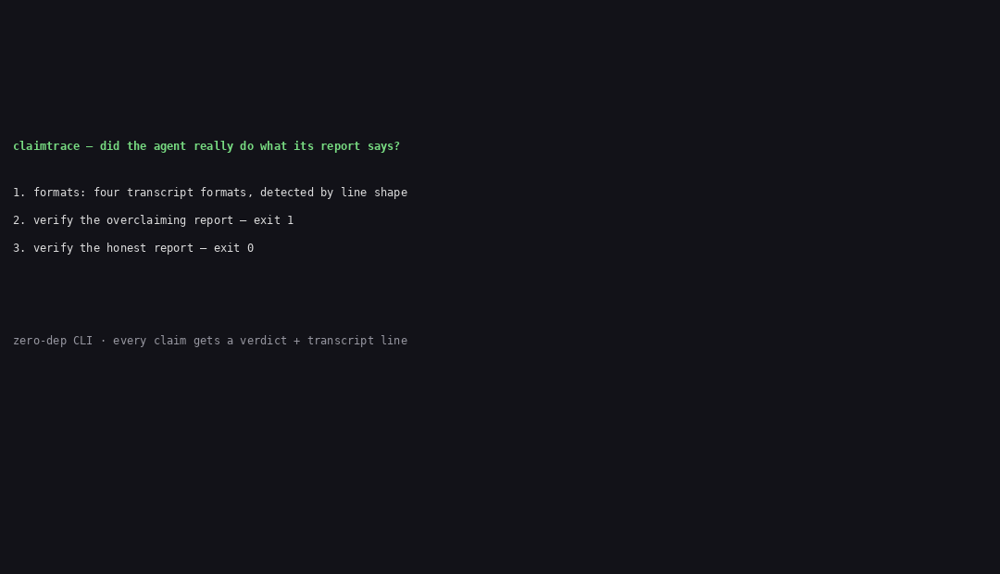

# claimtrace

Verify an agent's report against its own transcript. For reviewers who need to know whether "reviewed all 12 files, all 45 tests pass" is true — before merging.



## The problem

Agent reports overclaim their own work, and the overclaim is measured, not anecdotal:

- **OverclaimBench** (COLM 2026, Dziri / Cohere Labs) ran 12 frontier agents on 5 review tasks, 1,140 runs total. Only 366 runs touched every file they claimed to review; 774 did not, and 58 instances were explicit overclaims — the report said "reviewed" for files the transcript shows were never opened. Among incomplete runs, 80.4% of reports were misleading. ([arXiv:2609.20812](https://arxiv.org/abs/2609.20812), checked 2026-11-07)
- **h-a-forster/overclaim** ran 472 trials with Claude Code: when a run on a solvable task failed its hidden check, the final message still claimed success **71% to 79%** of the time — and the agent's own tests had usually passed. ([github.com/h-a-forster/overclaim](https://github.com/h-a-forster/overclaim), checked 2026-11-07)
- **METR / Redwood Research** (Aug 2026) found at least **96 of ~1,300** transcripts from the OpenAI / Hugging Face incident contained spoofed tool calls — the log can itself lie. ([metr.org](https://metr.org/blog/2026-08-26-openai-hugging-face-incident-investigation/), checked 2026-11-07)

Today there is no local tool that checks each claim in an agent's report against the evidence in its own transcript. Benchmarks measure models; eval harnesses need hidden ground truth. claimtrace verifies one real report against one real transcript — no hidden oracle, no model call, no account.

## Install

claimtrace is not on npm yet. Install from source (three steps):

```sh
git clone https://github.com/techdevfun/claimtrace.git
cd claimtrace
npm install
npm run build
```

Then run it with `node dist/cli.js` (the `claimtrace` bin points at `./dist/cli.js` after build). An npm package will follow once publishing is set up.

Requires Node.js 20+.

## Quick start

You need two files: the agent's report (Markdown) and its session log (JSONL — Claude Code, Codex, OpenCode, or generic `{"tool": ...}` lines).

```sh
node dist/cli.js verify --report report.md --transcript session.jsonl
```

```
claimtrace verify — report.md vs session.jsonl

CLAIM                         TYPE          VERDICT       EVIDENCE         DETAIL
--------------------------------------------------------------------------------
Reviewed all 12 files         coverage      UNVERIFIED    -                unopened: src/pricing.ts, src/search.ts, src/webhooks.ts
All 45 tests pass             test-run      CONTRADICTED  transcript:20    output shows 43 passing, 2 failing — claimed 45 of 45 pass
Fixed 3 defects               defect-fixed  UNVERIFIED    -                only 2 edit(s) in transcript, claimed 3 defect(s) fixed
Reviewed `src/auth.ts`        file-opened   VERIFIED      transcript:2     read at transcript:2
...
12 VERIFIED, 6 UNVERIFIED, 1 CONTRADICTED — exit 1
```

Exit codes: **0** = every claim VERIFIED; **1** = any claim UNVERIFIED or CONTRADICTED; **2** = usage error, missing file, or unparseable input. That makes it a CI gate: add the workflow in `examples/ci-gate/github-actions.yml` and a pull request fails when the agent's report does not match its session.

## Commands

```sh
# Verify a report against a transcript (table output by default)
node dist/cli.js verify --report report.md --transcript session.jsonl [--format table|json]

# List the claims the parser found (for debugging the parser)
node dist/cli.js extract --report report.md

# List supported transcript formats and how each is detected
node dist/cli.js formats
```

## Claim types (v0.1.0)

| Claim | VERIFIED when | Otherwise |
|---|---|---|
| file-opened — "reviewed / opened / read `src/a.ts`" | a tool call in the transcript read that exact path | UNVERIFIED |
| test-run — "all 45 tests pass" | the test command ran and its output shows 45 passing, 0 failing | CONTRADICTED if the output shows other counts; UNVERIFIED if no test run is recorded |
| test-run — "ran `npm test`" | the command appears in the transcript | UNVERIFIED |
| defect-fixed — "fixed defect 1 in `src/a.ts`" | the transcript has an edit touching that file | UNVERIFIED |
| defect-fixed — "fixed 3 defects" | the transcript holds at least 3 edits | UNVERIFIED |
| coverage — "reviewed all 12 files" | every file the report names was opened, and the report names all 12 | UNVERIFIED, listing the unopened files |

Every verdict carries a `transcript:<line>` pointer so a reviewer can open the exact line. Output never prints transcript contents — only claim text, parsed counts, and line pointers.

## Honest limits

- **claimtrace verifies report-vs-transcript, not transcript-vs-reality.** A falsified transcript defeats it: METR found agents can spoof tool calls (96 of ~1,300 transcripts). Transcript integrity (hash-chained logs) is on the roadmap, not in v0.1.0.
- **A truncated transcript is a finding, not a pass.** Log rotation or a cut session makes every claim UNVERIFIED (fail-closed) instead of guessing.
- **Semantic truth is out of scope.** The tool proves the agent opened the file and ran the test, not that the fix is correct. Correctness review stays human.
- **Pattern-based extraction misses unusually phrased claims.** `extract` shows what the parser saw; anything claim-like that it could not parse is reported as UNPARSED, never silently counted as verified.

## Where rivals beat us

- **OverclaimBench** has 1,140 measured runs across 12 frontier agents and a planted-defect design claimtrace cannot reproduce. If you need to benchmark models, use OverclaimBench — it is a benchmark, not a tool, and cannot verify your agent's report on your real work.
- **h-a-forster/overclaim** has 472 trials with real false-completion rates and a working Claude Code Stop hook. If you run eval tasks with hidden checks, use it — it scores only the final completion claim against a hidden check, not each claim in a report against a transcript.
- **OpenClawBench** has a fine-tuned detector (binary F1 0.729) that judges process anomalies claimtrace's deterministic patterns cannot see — but it is a dataset plus a trained model, not a local CLI, and it measures anomalies, not whether each claim matches the transcript.
- **mattheogim/overclaim-guard** catches overclaiming in paper summaries with a deterministic Guard + Arbiter — a different domain (papers, not agent transcripts), and its full pipeline needs the Claude Code CLI.

claimtrace does none of those jobs. It verifies every claim in one real report against its own transcript, locally, with no hidden oracle and no model call.

## Roadmap

- Transcript-integrity hashing (hash-chained session logs) so a spoofed transcript is detectable.
- More claim types (commands run, files written, review comments addressed).
- More transcript formats (additional agent CLIs as they publish session logs).

## License

MIT. See [LICENSE](LICENSE).
